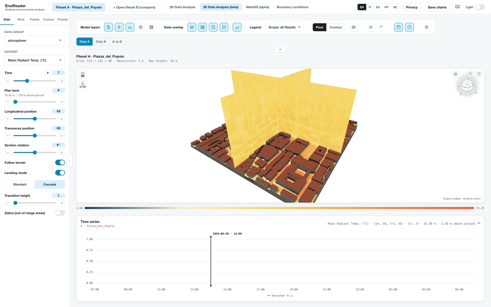
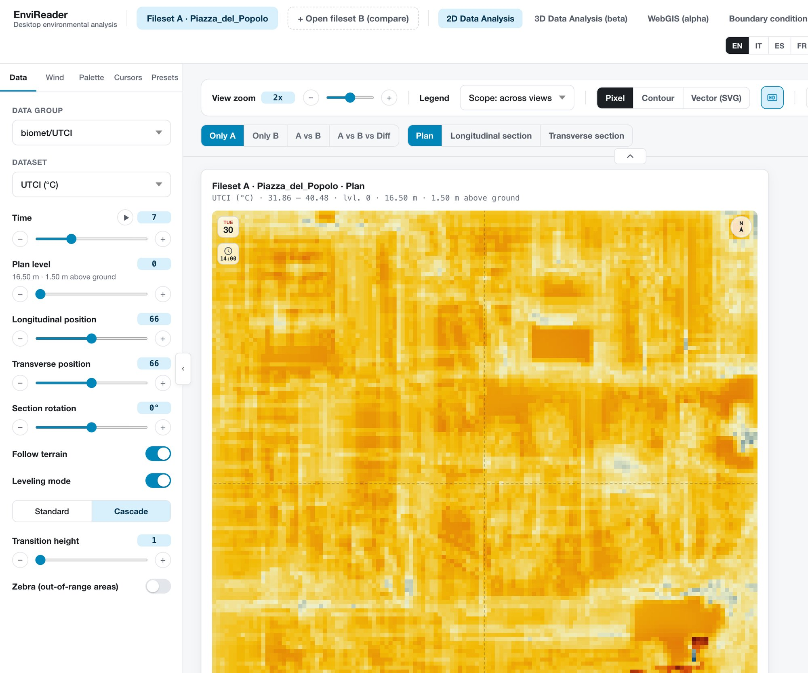
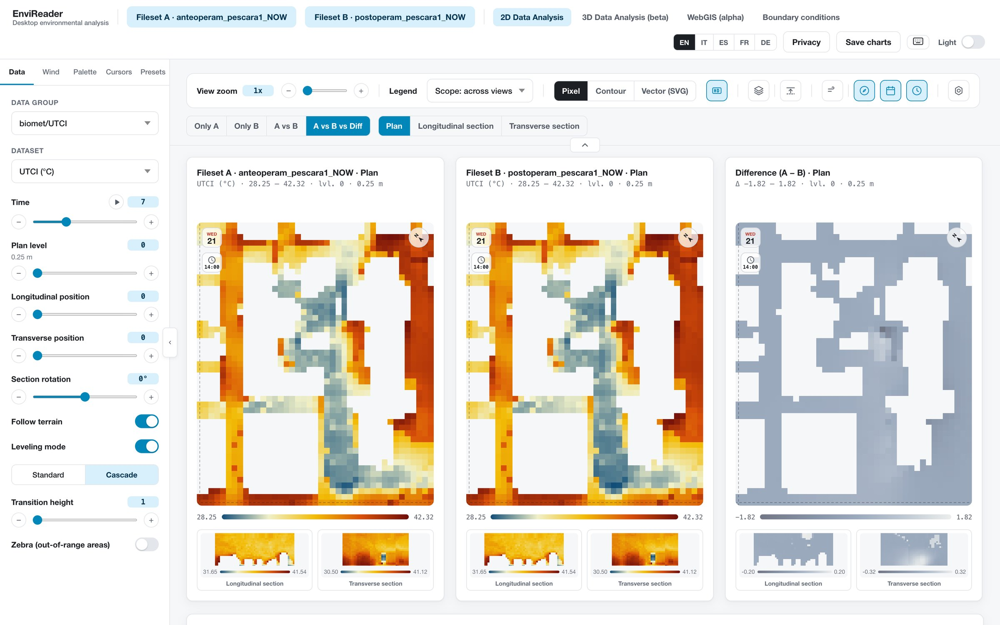
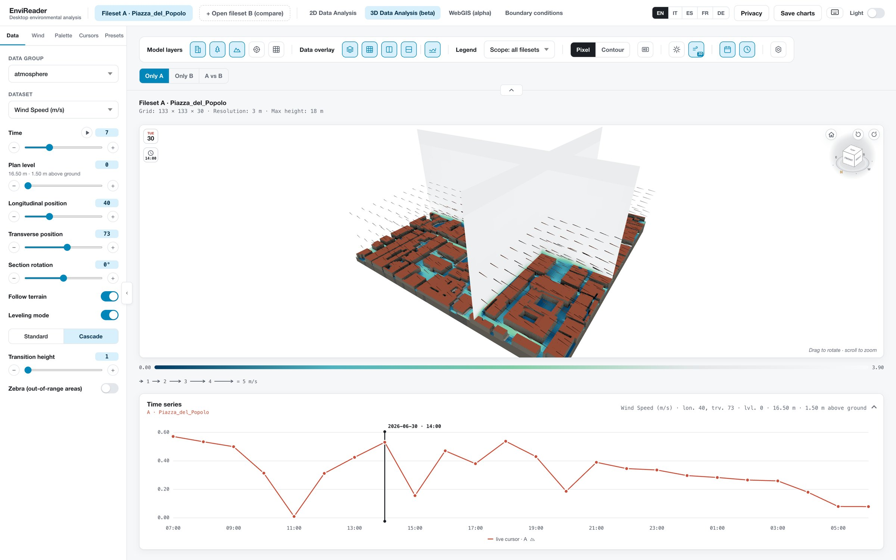
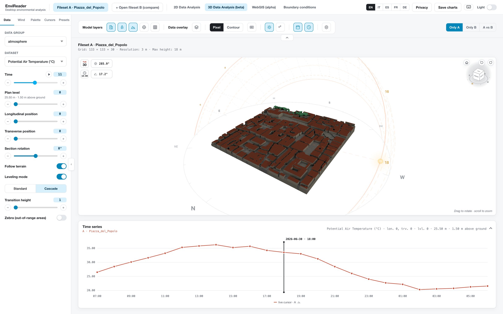
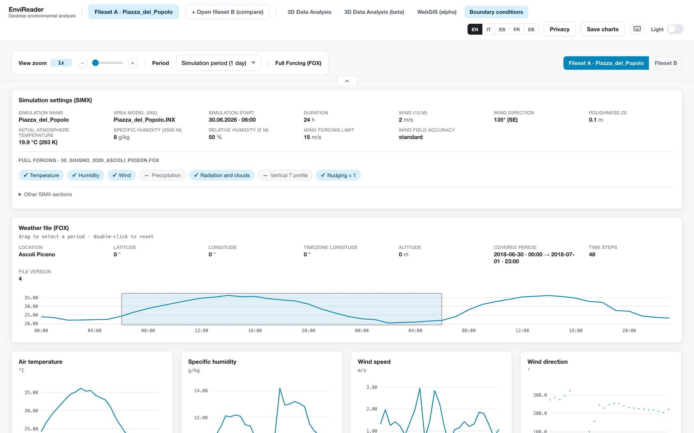

An ENVI-met simulation leaves a folder of binary files, one per output
time, and looking at them takes software that not everyone who needs the
results has installed. EnviReader opens that folder in a web page. The
person who ran the simulation, a colleague reviewing it, a student or a
designer comparing two scenarios all look at the same data.

Nothing is installed and nothing is uploaded: the files are read inside
the page. It reads the EDX/EDT pairs, the INX model, the SIMX settings and
the FOX forcing file. It does not compute anything: UTCI and the other
quantities are the ones ENVI-met wrote.

[EnviReader 2.0.1, trailer](https://youtu.be/b97523Jp3b0 "EnviReader 2.0.1: the trailer, 64 seconds.")

## What version 2 does

Version 2 is a rewrite, and the current release is 2.0.1. It has four
views: 2D Data Analysis, 3D Data Analysis (beta), WebGIS (alpha) and
Boundary conditions. The first three share one sidebar and one state:
time, level, sections, dataset, palette and wind settings stay as they are
when you switch view.

- **Maps and sections.** Plan and the two vertical sections, with a
  crosshair shared between them and a tooltip on every cell. The sections
  can be rotated to any angle.
- **Follow terrain.** The plan level counts from the ground instead of
  from a fixed height, with two leveling modes, *Standard* and *Cascade*.
- **Biomet section fix.** In biomet outputs (PMV, PET, SET, UTCI) ENVI-met
  stores each column against the bottom of the domain. EnviReader puts the
  values back above buildings and terrain, in 2D, in 3D and in the time
  series.
- **Time.** A player with 1×, 5× and 10× speed, and a time series at the
  crosshair. Saved cursors add one curve each, so several points of the
  same model can be compared over time.
- **A vs B.** A second simulation next to the first, with a cell-by-cell
  difference map on a scale symmetric around zero.
- **3D view.** The dataset as plan and sections inside the model, sun and
  shadows for the date and time of each step, wind on the slices or as a 3D
  volume, receptor charts, and A vs B with linked cameras.
- **WebGIS.** The model placed on a map at its real position, with a
  calibration for offset and rotation. The basemap loads only after your
  consent.
- **Boundary conditions.** The SIMX settings in plain text, and the Simple
  or Full Forcing series as charts, one for each quantity in the FOX file.
- **Colours and presets.** Scientific palettes, the 62 palettes of version
  1, your own palettes and presets, shareable as a file or a text code.
- **Export.** PNG, hybrid SVG that opens in Illustrator or Inkscape,
  animated GIF, CSV and Excel. Export always starts from the 2D view: the
  3D and WebGIS views are not exported.

The interface is available in English, Italian, Spanish, French and
German, with a light and a dark theme.

## Try it

The live app runs in Chrome, Edge, Firefox and Safari. Click *+ Open
fileset A* and choose the output folder of a simulation. Open a second
one as fileset B to compare the two. The source code, the releases and a
short clip for each feature are [on GitHub](https://github.com/grazianoEnzoMarchesani/EnviReader).

EnviReader is open source and is developed at the School of Architecture
and Design Eduardo Vittoria, University of Camerino, by Graziano Enzo
Marchesani, Roberta Cocci Grifoni and Mohammadjavad Khodaparast. If you
use it in your work, please cite the DOI above.

$$$

Una simulazione ENVI-met lascia una cartella di file binari, uno per ogni
istante di output, e per guardarli serve un software che non tutti, in un
progetto, hanno installato. EnviReader apre quella cartella in una pagina
web. Chi ha lanciato la simulazione, il collega che la rivede, lo
studente o il progettista che confronta due scenari vedono gli stessi
dati.

Non si installa niente e non si carica niente: i file vengono letti dentro
la pagina. Legge le coppie EDX/EDT, il modello INX, le impostazioni SIMX e
il file di forzante FOX. Non calcola nulla: UTCI e le altre grandezze sono
quelle scritte da ENVI-met.

[EnviReader 2.0.1, trailer](https://youtu.be/b97523Jp3b0 "EnviReader 2.0.1: il trailer, 64 secondi.")

## Cosa fa la versione 2

La versione 2 è riscritta da zero, e quella attuale è la 2.0.1. Ha quattro
viste: 2D Data Analysis, 3D Data Analysis (beta), WebGIS (alpha) e
Boundary conditions. Le prime tre condividono la stessa sidebar e lo
stesso stato: istante, livello, sezioni, dataset, palette e impostazioni
del vento restano uguali quando si cambia vista.

- **Mappe e sezioni.** Pianta e due sezioni verticali, con un mirino
  condiviso e un tooltip su ogni cella. Le sezioni si possono ruotare a
  qualsiasi angolo.
- **Segui il terreno.** Il livello della pianta si conta dal suolo e non
  da una quota fissa, con due modalità di livellamento, *Standard* e
  *Cascade*.
- **Correzione delle sezioni biomet.** Nei risultati biomet (PMV, PET,
  SET, UTCI) ENVI-met salva ogni colonna rispetto al fondo del dominio.
  EnviReader rimette i valori sopra edifici e terreno, in 2D, in 3D e
  nella serie temporale.
- **Il tempo.** Un lettore con velocità 1×, 5× e 10×, e la serie
  temporale nel punto del mirino. Ogni cursore salvato aggiunge una curva,
  così si confrontano nel tempo più punti dello stesso modello.
- **A vs B.** Una seconda simulazione accanto alla prima, con la mappa
  della differenza cella per cella su una scala simmetrica attorno allo
  zero.
- **Vista 3D.** Il dataset come pianta e sezioni dentro il modello, sole e
  ombre per data e ora di ogni istante, vento sulle fette o come volume
  3D, grafici dei ricettori e A vs B con camere collegate.
- **WebGIS.** Il modello posizionato su una mappa nella sua posizione
  reale, con una calibrazione di spostamento e rotazione. La mappa di
  sfondo si carica solo dopo il tuo consenso.
- **Condizioni al contorno.** Le impostazioni del SIMX in chiaro, e le
  serie di Simple o Full Forcing come grafici, uno per ogni grandezza del
  file FOX.
- **Colori e preset.** Palette scientifiche, le 62 palette della versione
  1, palette e preset personali, condivisibili come file o come codice di
  testo.
- **Esportazione.** PNG, SVG ibrido che si apre in Illustrator o Inkscape,
  GIF animata, CSV ed Excel. L'esportazione parte sempre dalla vista 2D:
  3D e WebGIS non si esportano.

L'interfaccia è in inglese, italiano, spagnolo, francese e tedesco, con
tema chiaro e scuro.

## Provarlo

L'app online funziona in Chrome, Edge, Firefox e Safari. Si clicca *+ Open
fileset A* e si sceglie la cartella dei risultati di una simulazione. Se ne
apre una seconda come fileset B per confrontarle. Il codice, le release e
una breve clip per ogni funzione sono [su GitHub](https://github.com/grazianoEnzoMarchesani/EnviReader).

EnviReader è open source ed è sviluppato presso la Scuola di Architettura
e Design Eduardo Vittoria, Università di Camerino, da Graziano Enzo
Marchesani, Roberta Cocci Grifoni e Mohammadjavad Khodaparast. Se lo usi
nel tuo lavoro, cita il DOI qui sopra.
